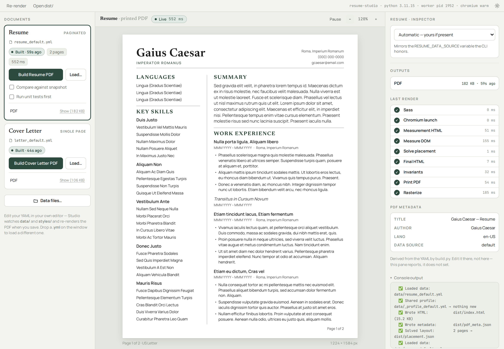
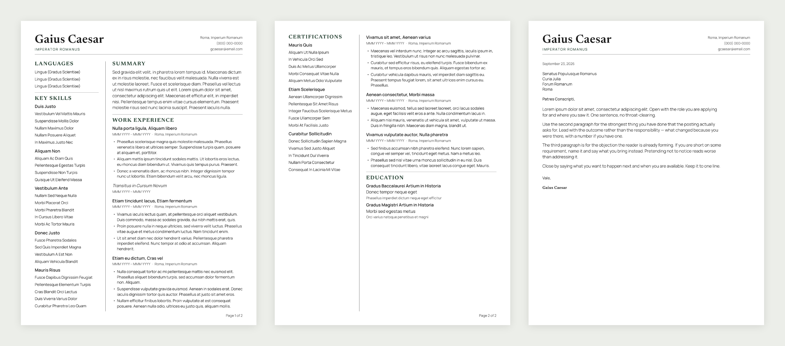
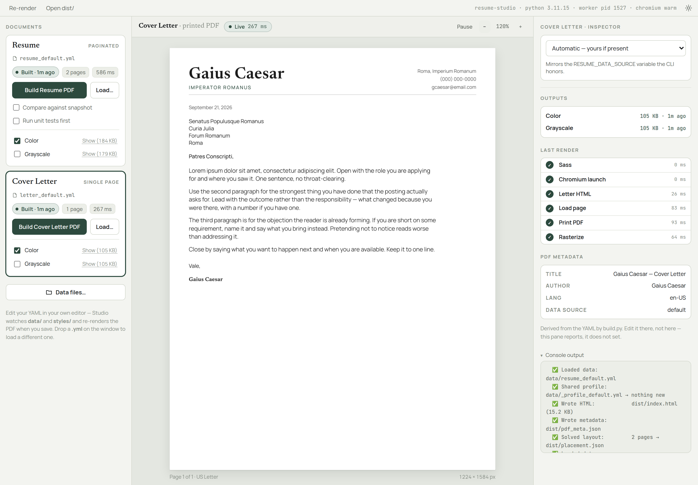

# Resume Studio

[](https://github.com/Vesselchuck/resume-studio/actions/workflows/tests.yml)
[](https://github.com/Vesselchuck/resume-studio/releases/latest)
[](LICENSE)

A desktop app for your resume and cover letter. You write both in YAML,
in whatever editor you like; the Studio shows the **real printed PDF**
every time you save, and builds a pixel-faithful US Letter PDF that
prints correctly in color and in black and white. Page breaks are
worked out for you, and the cover letter reuses the resume's header so
the two read as a set.

What changed and when — including anything that makes an old data file
stop working — is in [CHANGELOG.md](CHANGELOG.md).

<picture>
  <source media="(prefers-color-scheme: dark)" srcset="docs/screenshots/studio-dark.png">
  
</picture>

<picture>
  <source media="(prefers-color-scheme: dark)" srcset="docs/screenshots/documents-dark.png">
  
</picture>

All screenshots show the placeholder data the project ships with
(`data/*_default.yml`).

## Getting started

### Requirements

- **Python** 3.14 recommended; 3.10+ works. CI runs the tests on
  3.14, and on 3.10 in a job of its own.
- **Node** 24 LTS recommended; 20.19+ works. Playwright 1.63 needs
  Node 20, and Sass (`sass-embedded`, and the file watcher it uses)
  needs 20.19. `package.json` declares the minimum (`engines`), and CI
  runs the tests on 24 and on 20.19. The compile cache that speeds up
  start-up needs 22.8+.
- **Rust** (stable, installed with [rustup](https://rustup.rs/)) for the
  desktop window. On Windows, Rust also needs the Microsoft C++ Build
  Tools, which the rustup installer offers to set up. No Rust? The same
  app runs in your browser — see below.
- **Chromium** for Playwright, installed in the setup step.

Every direct dependency is exact-pinned in `requirements.txt`, and
every Node package in `package-lock.json`.

### One-time setup

In the project folder:

```powershell
# Windows (PowerShell or cmd.exe)
py -m pip install -r requirements.txt
npm ci
npx playwright install chromium
```

```bash
# macOS / Linux
pip install -r requirements.txt
npm ci
npx playwright install chromium
```

Use `npm ci`, not `npm install`: it installs exactly what
`package-lock.json` says and fails if `package.json` disagrees with it.

### Open the Studio

On Windows, double-click **`studio.bat`** in the project folder. From a
terminal, on any platform:

```
npm run studio
```

The first start compiles the desktop shell and takes a few minutes;
later starts take seconds. The console window stays open while the app
runs, and closing it stops the app.

Without a Rust toolchain, open the same app in your browser instead:

```
npm run ui
```

It opens the address the terminal prints, which carries a token made
fresh at each start; your browser keeps it in a cookie for that run.
The bare address without it opens nothing but a page saying where to
open the Studio from, so a bookmark does not work: use the printed
link each time. If the server is started again, a page still open
from the earlier run says that this Studio run has ended; open the
new link.

| Command                | Does                                               |
|------------------------|----------------------------------------------------|
| `npm run studio`       | The desktop app (also: double-click `studio.bat`)  |
| `npm run ui`           | The same app in your browser — no Rust needed      |
| `npm test`             | Run the full test suite                            |
| `npm run studio:build` | Compile the desktop app to an installer (see below) |

The installer does not work on its own yet. It bundles the build
scripts, templates, styles and fonts but not `node_modules/`, so the
installed app cannot load Playwright or Sass from its install folder;
it also needs Node and Python with the packages from the setup step,
and it keeps `data/` and `dist/` in its install folder, which is often
read-only. Until that changes, run the app from the project folder
with `npm run studio`.

The Studio finds the right Python interpreter by itself. If that ever
fails (the usual cause is the Microsoft Store `python` alias on
Windows), set `PYTHON` before starting it — see the FAQ.

## Using the Studio

A three-pane window: your documents on the left, the **real printed
PDF** in the middle, an inspector on the right. Edit the YAML in
whatever editor you like and the pane follows.

<picture>
  <source media="(prefers-color-scheme: dark)" srcset="docs/screenshots/studio-letter-dark.png">
  
</picture>

The preview is not a screenshot of the HTML. It prints a real PDF,
sets the same US Letter page boxes `crop_pdf.py` sets, and rasterizes
it with the same function the visual-regression test uses — so what
you see is the output, post-crop, at true 612 × 792 pt. The preview
sets the boxes in memory instead of rewriting the file (the rewrite
took longer than printing); a Build still crops the file itself and
stamps its metadata, and a test checks the two give the same pixels.

**Build** writes the finished PDF to `dist/`. It runs the same build
scripts (`resume.js`, `letter.js`) that the command line uses for
debugging, so there is exactly one way to produce a PDF worth sending,
and building the resume cannot touch the cover letter's files. There is
nothing to choose: each document builds one PDF. Pressed while a
preview is rendering, Build waits for it and starts as soon as it
finishes, and its button says it is queued; builds of both documents
pressed meanwhile run one after the other, in the order pressed.
**Show in folder** opens your file manager on the built PDF;
it shows only `dist/` or a file in it.

Each card chooses its own data file. The cover letter reads the file
picked on its card, or else `data/letter.yml`, or else
`data/letter_default.yml`; the resume card's choice never changes it,
and the reverse. Data-file variables set in the shell that started the
Studio (`RESUME_DATA_FILE` and the rest) are ignored, so the card
always names the file the preview and the build read.

Two checkboxes on the resume card:

| Checkbox | Default | Effect |
|----------|---------|--------|
| Compare against snapshot | off | Runs the pixel diff and reports differences. Never blocks. |
| Run unit tests first     | off | Runs the full suite before building — a couple of minutes. See "Why the tests can be skipped". |

**Dropping a file** works out which document it is by reading it, not
by its name: the resume needs `sidebar` and `mainColumn` at the top
level and the letter needs `letter`, so a file with one set of keys
and not the other can only be the one document. A file with both
could be either (it passes both builders), and a file with neither is
neither; for those the app asks instead of guessing, and **Data
files…** asks the same question about such a file already in `data/`.
A file saved with a byte-order mark (Notepad's "UTF-8 with BOM") is
read the same as one without. Nothing in `data/` is ever overwritten — a
dropped file is read in place if it is already there, saved under its
own name if not, and a name collision offers you a choice rather than
replacing anything. A file whose name starts with `_` is refused:
those names are reserved for the shared profile.

**When a render fails** — a typo in the YAML, a value the schema
refuses — the preview keeps the last good render, dimmed, with its time
("Showing last good render · 14:02"), and a panel over the top of it
says where the problem is first: `data/resume.yml:42:5`, then the
message. **Copy location** puts `file:line:column` on the clipboard;
**Open in VS Code** opens the file at that line when VS Code is
installed (Windows: the `vscode://` link handler in the registry), and
otherwise the button reads **Open file** and opens it in its default
program, which cannot be sent to a line. Only files in `data/` and
`styles/` can be opened this way. The panel goes when the next save
renders.

**What changed** after each render is outlined on the page for four
seconds (a still outline, then gone, if your system asks for reduced
motion), so an edit's knock-on reflow is visible without comparing by
eye. **Highlight changes** in the preview's toolbar turns it off.

**Zoom.** 100% is the page's true size, 8.5 inches across. **Fit
width** (the default) and **Fit page** size the page to the pane and
follow the window as it is resized. Fit width puts both pages of the
résumé side by side when the pane can show them at 70% or more, and
one page across when it cannot. Either fit stops at 150%: the preview's images
are 1224 px across, and a fit does not enlarge them past that on a
wide screen. The zoom buttons go on to 200%. Ctrl+wheel (or a pinch) over the
pages zooms the preview; elsewhere it zooms the whole window, like
Ctrl+plus and Ctrl+minus, which are left to the browser on purpose so
the interface's text can always be enlarged.

**Diagnostics** — the engine (Python version, worker pid, whether
Chromium is warm), each phase of the last render in milliseconds, and
the console output — sit in one disclosure at the foot of the
Inspector, closed until a render or build fails. The console holds
everything the server prints, errors and warnings included: a
Chromium that will not launch, a page that timed out, a failed
build's headline, a warning that a key in your YAML is ignored.

The last page's fill ("last page 72% full" on the resume card) is how
far down its body the lowest content on the last page reaches: room
for another line, or a page about to spill.

### Keyboard shortcuts

| Keys | Does |
|------|------|
| F5 or Ctrl+R | Re-render the preview (works with a dialog open too; reloads the page only once this Studio run has ended) |
| Ctrl+Shift+B | Build the PDF of the document on screen (during a preview, once it finishes) |
| Ctrl+1, Ctrl+2 | Show the Resume, the Cover Letter |
| Ctrl+Tab, Ctrl+Shift+Tab | Switch between Resume and Cover Letter (not in a Chrome tab) |
| Ctrl+Shift+P | Pause or resume auto-render |
| Ctrl+O | Data files: choose which file to read |
| Ctrl+Shift+D | Show or hide Diagnostics |
| Ctrl+Shift+L | Theme: System, Light, Dark in turn |
| Ctrl+8, Ctrl+9 | Preview: fit width, fit page |
| + − 0 (preview focused) | Preview: zoom in, zoom out, actual size |
| Ctrl+wheel over the pages | Preview: zoom |
| F6, Shift+F6 | Move between Documents, Preview and Inspector |
| F1 or Ctrl+/ | List the shortcuts |
| Ctrl+plus, Ctrl+minus, Ctrl+0 | Zoom the whole interface |

In a browser tab (`npm run ui`) Chrome keeps Ctrl+Tab for its own tab
strip, and a browser may keep Ctrl+1, Ctrl+2, Ctrl+8 and Ctrl+9 too;
the document cards and the toolbar do the same things.

### Settings

The theme (System, Light or Dark, top right), the zoom, the two
checkboxes, the highlight and whether Diagnostics is open are kept in
`dist/.studio-prefs.json`, not in the browser's storage: the desktop
app's page comes from a new port every launch, and a browser forgets
storage between origins, so settings kept there were lost on every
restart. `dist/` is the one folder the Studio already writes, and it
is never committed; delete the file to go back to the defaults.

## Editing your resume

**`data/resume.yml` is yours.** It is gitignored, and the Studio prefers
it over everything else. `data/resume_default.yml` is the placeholder
the repo ships (Gaius Caesar) so a fresh clone still builds; it is the
one that is committed.

The unsuffixed name belongs to the real document on purpose: the file
you edit every week should have the obvious name, and the one you touch
once should carry the qualifier.

Starting from the template, copy it to your own file:

```powershell
# Windows (PowerShell)
Copy-Item data\resume_default.yml data\resume.yml
```

```bash
# macOS / Linux
cp data/resume_default.yml data/resume.yml
```

Then open `data/resume.yml` in your editor. The Studio switches to it by
itself and re-renders the preview on every save. (**Data files…** in the
Studio lists everything in `data/`, and you can also drop a `.yml` file
onto the window.)

The PDF metadata manifest records which data source was used —
`default` for the template, `mine` for `data/resume.yml`, `explicit`
for any other file — so the snapshot test picks the matching fixtures,
or skips the check for an `explicit` file, which has none.

### The shared profile

`data/_profile.yml` holds what is true of you regardless of which job
you are applying for — your name, your contact details, the document
language and the page ceiling. Every build merges it **underneath** the
document it is building.

Your document always wins: anything it sets for itself is used, and the
profile only fills in what the document leaves out. So a phone number
lives in one file instead of one per application.

Mappings merge key by key: a document that sets only `contact.rows`
keeps the profile's `contact.address`. Lists are replaced, not
combined. A key left empty in the document (`contact:` with nothing
under it) counts as not set, so the profile's value is used; with no
value in the profile either, it is the same as leaving the key out.
That holds for `role:`, `contact.address:` and a link's `href:` too.

Nothing references the profile by name. It applies to every `.yml`
beside it in `data/` simply by being there, and the build says so on
every run:

```
✅ Shared profile:        data/_profile.yml → contact, meta.lang, meta.maxPages, name
```

That line is the whole reason an implicit merge is acceptable: a value
can reach the PDF from a file the document never mentions, so the build
states which ones did, every time.

| Belongs in the profile | Belongs in each document |
|------------------------|--------------------------|
| `name`                 | `role` — names the job you are applying for |
| `contact`              | `meta.description` — names it too |
| `meta.lang`            | everything under `sidebar` / `mainColumn` / `letter` |
| `meta.maxPages`        | a `maxPages` override, if one document needs more room |

To turn the whole mechanism off, delete `data/_profile.yml`. Every
document still carries whatever it carries — though one you have
already stripped will be missing a name until you put one back.

`data/_profile_default.yml` is the shipped starting point; copy it to
`data/_profile.yml` and edit that.

**The templates never see your profile.** `resume_default.yml` and
`letter_default.yml` merge `_profile_default.yml`; only your own files
merge `_profile.yml`. The committed snapshot fixtures are rendered from
the templates, so if a template could borrow from your profile, your
phone number could end up in a file that goes to the repository.
`build.profile_for` decides which profile a document gets, by whether
its file name ends in `_default`.

## Editing your cover letter

The cover letter works exactly like the resume: copy the template to
your own file, select **Cover Letter** in the Studio, and edit. Yours is
`data/letter.yml` (gitignored); `data/letter_default.yml` is the shipped
placeholder.

```powershell
Copy-Item data\letter_default.yml data\letter.yml
```

It reproduces the resume's header verbatim so the pair matches, and
draws `name` and `contact` from the same `_profile.yml` the resume
uses — which is how the two stay in sync.

### There are only two fields

`letter.body` and `letter.recipient`. That is the whole letter.

**`body`** is the entire letter, greeting and sign-off included. Write
it as one block (paste paragraphs separated by a blank line) or as a
list, one entry per paragraph; `**bold**` works just like resume
bullets.

```yaml
letter:
  recipient: |
    Hiring Team
    Acme Corp
    100 Main St
    Springfield, IL 62701

  body: |
    Dear Hiring Team,

    One sentence naming the position and where you saw it.

    The strongest thing you have done that the posting asks for.

    Sincerely,
```

"Dear Hiring Team," and "Sincerely," are paragraphs like any other.
They used to be `salutation` and `closing` fields, which meant three
places to edit one letter and two of them easy to forget.

**`recipient`** takes a block too — paste an address straight out of a
job posting. It splits on **every** line, not on blank ones the way
`body` does: an address line is not a paragraph, and "Acme Corp" and
"100 Main St" must not be glued together. Blank lines in what you
pasted are dropped. The list form still works. `recipient: []`, like
leaving the key out, means no address block.

**Your name** under the sign-off is not in this file at all. It comes
from `name` in `data/_profile.yml`, the same place the resume gets it,
so it is right on every letter without being written on any of them.

A `salutation:`, `closing:` or `signature:` left in an old file is
rejected with the line to write instead — silently ignoring one would
drop the greeting off the letter without a word. An unknown key in
`name`, `contact` or a contact row stops the build, as it does the
résumé's: those usually come from the profile both documents share.
Any other key the letter does not read, a misspelled `recipent:` say,
is printed as a warning, with a suggestion when it looks like a typo
of a real key.

Quote a list-form paragraph that contains a colon followed by a
space — `- "Dear Team: thank you for your time."` — or YAML reads it
as a key and a value, and the build refuses it and says so. The block
form (`body: |`) needs no quotes.

Output: `dist/Gaius_Caesar_Cover_Letter.pdf`.

### The build refuses a letter that does not fit

The Studio's preview runs the same check, and shows "Layout check
failed" for a letter that runs off its page.

`.page` is a fixed 8.5 × 11in box with `overflow: hidden`. The resume
never meets that limit because its solver decides in advance what goes
on each page; the letter is one fixed sheet by design and has no
solver. So a letter that runs long is not spilled onto a second page —
it is **clipped**, and the closing paragraph and your signature come
off the bottom while the build reports success.

`verifyLetterFits` in `build/pipeline.js` stops that. It fails the
build and says how far over you are:

```
❌ The letter does not fit on one page
   It runs 138px past the bottom margin — roughly 7 lines of text.
```

It measures the letter's last child, not `.letter` itself: `.letter`
is a flex item with `flex: 1 1 auto` and `min-block-size: 0`, so its
own bottom edge sits on the page's content bottom no matter how long
the letter is. Measured that way the overflow is always exactly zero —
a check that looks like it passes and tests nothing.

### Letter typography

Three things are set on `.letter-body p` and nowhere else:

- `hyphens: none` — a formal letter read once shouldn't break words.
- `text-wrap: pretty` — avoids a single word alone on a last line.
  Ignored by renderers that don't support it, which is the right
  failure mode.
- `orphans: 2; widows: 2`, plus `break-before: avoid` on the
  signature so a name never lands alone at the top of a page.

They are deliberately **not** in `_base.scss`. The resume's solver
measures rendered block heights and then decides pagination from those
numbers, so anything that moves a line break moves the numbers it
solves from — and the committed pixel fixtures with them. The letter
has no solver, so it can ask for better line breaking. Nothing here
changes type size, weight, color or rhythm, so the two documents still
look like a pair.

The greeting and the sign-off keep the air they had as separate
fields, restored structurally:

```scss
.letter-body p:first-child { margin-block-end:   calc(var(--sp-xl) - var(--sp-lg)); }
.letter-body p:last-child  { margin-block-start: calc(var(--sp-xl) + var(--sp-sm) - var(--sp-lg)); }
```

16px above the body and 22px above the sign-off — the old `.letter`
gap, and the old `.letter-signoff` gap including its `--sp-sm` nudge.
Written as the arithmetic rather than as literals so they follow the
spacing scale if it is retuned.

### The date is not in the YAML

There is no `letter.date` field. The build stamps the day it runs,
because that is the only date a cover letter can carry honestly: a date
you typed is correct on the day you typed it and quietly wrong every
day after, and the reader most likely to notice is the one deciding
whether to interview you.

How it is written follows `meta.lang`:

| `meta.lang`                          | printed as           |
| ------------------------------------ | -------------------- |
| `en-US` (and bare `en`)              | `September 20, 2026` |
| `en-GB`, `en-AU`, `en-IE`, `en-IN`, … | `20 September 2026`  |
| anything not English                 | `2026-09-20`         |

`en_GB` is read as `en-GB`, and the regions `150` (Europe) and `001`
(world) are day-first too. Anything after a private-use `x-` is not a
region, so `en-x-gb` prints the US form.

The ISO fallback is deliberate. Printing "September" to a reader of
German or Japanese would be worse than printing the one format every
locale reads correctly, and this project has no translated month names.
The month names it does have are written out in `build_letter.py`
rather than taken from `strftime("%B")`, which consults `LC_TIME` — so
the same data file builds the same letter on every machine.

The rendered HTML carries both forms: `<time datetime="2026-09-20">`
around the printed text.

A `date:` left in an old `letter.yml` is **rejected**, not ignored —
the build stops and tells you to delete the line. Silently ignoring it
would leave you editing a line with no effect and finding out from a
letter dated differently to the file that made it.

## What you can change in the YAML

- **Personal info** — `name.first`, `name.last`, contact details.
  One of the two name parts may be blank (a single name is still a
  name); both blank builds with an empty heading, and the build warns
  about it. A `role`, a `contact.address` or a contact row's text that
  is only spaces is left out, with a warning, rather than printed as
  an empty line; leave the key out, or empty, instead.
- **Sidebar blocks** — add, remove, reorder under `sidebar.blocks`.
  Each block has a kebab-case `id` (must be unique, and not the `id`
  of a job either: both become ids on the same page), a `type`
  (`details` or `list`), a `heading`, and content. The first block
  with `id: key-skills` (or heading "Key Skills") drives the PDF's
  /Keywords metadata. An empty heading is refused; one of only
  spaces prints empty, and the build warns about it. A block needs at
  least one entry: a heading
  with nothing under it is refused. A `- group:` sub-heading with no
  lines under it prints over nothing, and the build warns about it.
- **Main column sections** — exactly one each of `summary`,
  `experience`, `education`. Add/remove jobs under
  `mainColumn[experience].jobs`. A job's `datetime` and an education
  entry's `subtitle` and `institution` are optional; leave one out and
  that line is simply not printed. A gap entry (`gap: true`) has no
  bullets (`bullets:` left empty, or `[]`, is the same). `items: []`
  under education leaves the section empty; its heading still prints,
  and the build warns about it.
- **Bullets** — add or remove freely under each job's `bullets:` list.
  Bullets support `**bold**` markdown; everything else is treated as
  plain text. The layout solver decides where page breaks land.
  Quote a bullet that contains a colon followed by a space —
  `- "Led the migration: cut costs 30%"` — or YAML reads it as a
  key and a value, and the build refuses it.
- **Page cap** — `meta.maxPages`, normally set once in
  `data/_profile.yml`. Lower it to force tighter layouts; the build
  fails clearly if content can't fit. Set it in a document to override
  the profile for that one.
- **Language** — `meta.lang: en-US` (BCP-47), also normally in the
  profile. Drives the document's `<html lang>` and the PDF's `/Lang`
  catalog entry. It should be a language tag: letters and digits in
  parts separated by `-` or `_` (`en-US`, `en_GB`, `de`), with `_`
  written as `-` (`en-GB`). Anything else marks the documents
  `en-US`, and the build warns about it. Left blank, it means `en-US`.
- **Links** — an `href` in a contact row or a details row is written
  in full: `https://example.com/me`, `mailto:you@example.com`,
  `tel:+15550100`. Those three and `http:` are the only kinds allowed.
  One without a scheme (`example.com/me`, `//example.com/me`,
  `you@example.com`) is refused: Chromium would read it as a file next
  to the page, and the PDF would link to a path on your computer. So is
  a host and port (`localhost:3000`, which reads as a scheme — write
  `https://localhost:3000`), a bare `https:` or `mailto:`, a Windows
  path, and every other scheme (`javascript:`, `file:`, `smb:`, …),
  since a PDF viewer hands those to whatever program the reader's
  system has for them. Invisible characters around an `href`, such as
  a no-break space that pasting from a web page can bring along, are
  removed, and the build names in a warning each one a browser would
  keep: Chromium keeps it, and the link would again point at a file on
  your computer. A `mailto:` or `tel:` with nothing visible after it
  prints as text, with a warning. Leave `href` out, or empty, for text
  without a link.
- **Long words** — a word wider than its column, such as a long URL,
  breaks at the column edge rather than running over the divider.

You do **not** need to manage page breaks manually. If you write 20
bullets across your jobs, the solver figures out where to break.

A misspelled key is never dropped silently. Where the schema lists
every allowed key — a job, `name`, `contact` and its rows, `sidebar`,
an education entry, a details row, a list group — an unknown key stops
the build. Anywhere else it is printed as a warning, with a suggestion
when it looks like a typo of a real key.

An error the build stops on starts with where it is, as
`data/resume.yml:42:9:`, the form terminals and editors turn into a
link. When the value came from `data/_profile.yml` rather than the
document, the error points into the profile and says so. A YAML
syntax error names its file too, with the line and column your editor
shows.

## Editing in VS Code

`.vscode/settings.json` maps the schemas in `schemas/` onto the data
files, which gives you key completion, type checking as you type, and
hover documentation for every field. It needs the **YAML** extension by
Red Hat (`redhat.vscode-yaml`); VS Code offers to install it the first
time it sees the file.

The schemas are advisory. `validate_data()` in `build/build.py` is the
authority, and `test_yaml_typing.py` asserts the two agree — an
advisory schema that disagrees with the authority is worse than none.

They are mapped in settings rather than by a `# yaml-language-server:`
comment at the top of each file, so nothing in `data/` is modified and
a new file picks up its schema automatically — as long as its name
starts with `resume` or `letter` and ends in `.yml` or `.yaml`, or
starts with `_profile` and ends in `.yml` (the build reads the profile
only as `_profile.yml`). A file with any
other name, such as `data/acme.yml`, gets no schema, because the name
is the only thing the editor has to go on.

**`yaml.schemaStore.enable` is `false`, and that matters.**
`resume.yml` is the canonical filename of [JSON
Resume](https://jsonresume.org/), a different and widely-used spec, and
SchemaStore's public catalog maps that exact name to it. Leave the
catalog on and your resume draws three errors — `role`, `sidebar` and
`mainColumn` "not allowed" — from a schema you never asked for. The
cost of turning it off is that the project's other YAML (the
workflows in `.github/workflows/` and `.github/dependabot.yml`) loses
catalog autocomplete.

## What gets generated

A resume build writes everything to `dist/`:

- `dist/index.html` — the rendered HTML (final mode by default)
- `dist/styles.css` — compiled from `styles/styles.scss` via Sass
- `dist/pdf_meta.json` — derived PDF metadata + data source identifier
- `dist/placement.json` — the solver's per-page placement decisions
- `dist/favicon.svg` — the page icon, in the accent color
- `dist/Gaius_Caesar_Resume.pdf` — the final PDF (US Letter)
- `dist/outputs.json` — the build record: which PDF each Build wrote,
  from which data source, with its SHA-256. The live preview never
  writes it, so it is what the snapshot tool and the stale-PDF cleanup
  go by.

While a build or a live preview is writing to `dist/`, it holds
`dist/.lock`, so `node resume.js` in a terminal and the Studio take
turns instead of overwriting each other's files. A lock whose process
has gone is taken over, and a build that waits says what it is
waiting for.

A cover letter build similarly writes `dist/letter.html`,
`dist/letter_meta.json`, `dist/favicon.svg` and
`dist/Gaius_Caesar_Cover_Letter.pdf`, and records that PDF in
`dist/outputs.json` too.

### How the PDFs get their names

The stem is `name.first` + `_` + `name.last` + `_Resume` (or
`_Cover_Letter`), taken from `data/_profile.yml`, so both documents
always agree. `build/_output_name.py` folds it into something a
filename can hold: accents are folded rather than stripped (José →
Jose), apostrophes are dropped (O'Brien → OBrien), and everything else
outside `[A-Za-z0-9]` becomes a single underscore. That is a deliberate
reduction — the filename travels through email clients, HR portals and
applicant-tracking systems that are much less careful with bytes than
the PDF's own metadata, where your name is stored exactly as you wrote
it.

A part of the name with letters that have no ASCII form (山田,
Смирнов) is kept in its own characters instead, with only the
characters a filename can't hold replaced: `Ivan Petrov-Смирнов` gives
`Ivan_Petrov-Смирнов_Resume.pdf`, not `Ivan_Petrov_Resume.pdf`.
Invisible text-direction controls are left out, since they can make a
file name display in a different order from the one it has. A name too
long for the file system (255 bytes on Linux and macOS; a CJK
character takes three) is shortened from the end of its longest part
until the PDF's name is at most 239 bytes: the PDF is first written
under a temporary name up to 16 bytes longer, and that one has to fit
too.

Only Python derives the name. Node reads it back from
`dist/pdf_meta.json` (`output_stem`) through `build/_output_name.js`,
because nothing on the Node side of this project parses YAML.

Rename yourself and the filenames move with you; the previous build's
PDFs are deleted from `dist/` at the end of the next build, so there is
never a second, plausible-looking resume sitting next to the current
one under an old name. Only names the build record says a build wrote
are touched, plus the names older versions wrote before outputs were
named after you (`resume-color.pdf` and the like), and a retired
`_Grayscale` or `-grayscale` copy, but only beside a color PDF of the
same name that a build recorded or has just written. A PDF you save in
`dist/` yourself stays, even one called `Acme_Resume.pdf` or
`Acme_Resume_Grayscale.pdf`. Every removal is printed.

The snapshot **fixture** keeps its fixed name
(`expected_resume.pdf`). It is a committed reference image;
naming them after whoever last built would churn `tests/fixtures/` on
every edit and put a real name into the repository that the placeholder
data exists to keep it out of.

### Text a machine can read

Applicant-tracking systems read the PDF's text, not its pixels, so the
build keeps that text equal to the words on the page:

- **No ligatures.** The fonts would draw "fi", "ff" and "tt" as single
  glyphs, and Chromium's PDF does not tell a reader which letters some
  of those glyphs stand for — pypdf read "Mattis" as "Mais". They are
  switched off in `styles/_base.scss` (`"liga" 0`).
- **Letter-spacing at most 0.1em** on anything uppercase and tracked.
  Wider, some readers take each letter as a word: the role line at
  0.15em came out as "I M P E R AT O R". The role line is small enough
  that pdftotext splits it even at 0.1em, so its 0.1em is built into
  its font instead (`Manrope Tracked`): the same pixels, and no gap
  between letters for a reader to break on. The section headings are
  tracked the same way (`Newsreader opsz18.67 Tracked`): as
  letter-spacing, Xpdf's pdftotext (the one Git for Windows ships)
  read "C E RT I F ICAT ION S" and "E DUCAT ION". So are the labels of
  a details block (`Manrope Tracked` 600), which poppler's pdftotext
  read as "SECURIT Y CLEARANCE".
- **Real spaces.** A space that is only markup between two elements
  can vanish from the text; the name's is inside the first one. And no
  letter is kerned against a space: Manrope pulled the space after a
  capital L, Y, T or K in by up to 0.05em, and Newsreader kerned A, V
  and others against it, so the letter's box overlapped the space and
  Xpdf's `pdftotext -raw`, pdfium and Tesseract read "ESLClassrooms"
  and "SQLServer". The font cuts carry no kerning against a space; the
  word after such a pair sits up to half a point further right.
- **Text in reading order.** Some readers take the text in the order it
  is written into the PDF, not by where it sits on the page, and
  Chromium writes it in paint order. Nothing inside a column is
  positioned (a positioned box paints after everything around it: the
  bullets once came after all of a page's job titles, and page 2's
  after Education). Page 1 paints its sidebar first and page 2 its
  main column first, so the main column reads unbroken across the
  page break, between page 1's sidebar and page 2's. Read in stream
  order, each bullet follows its own job and reads in one piece, and
  the "Page 1 of 2" footer comes last on its page, outside every
  section; on the page nothing moved. Past two pages no order keeps
  the main column unbroken.
- **No odd characters.** No space a reader may not split words on, no
  zero-width character, no U+FFFD, no private-use code point and no
  soft hyphen, read with pypdf and pdfium (poppler's pdftotext turns
  U+00A0 into a space, so it would not see one). No `/ActualText`
  either: a reader that honours it and one that doesn't would read
  different words.
- **No hidden text.** Every glyph is at least 4pt, clearly darker than
  the page (at least 15 RGB units from white), drawn with a visible
  render mode and inside the page: the rules published hidden-text
  detectors apply.
- **What parsers document asking for.** Each job's dates read on one
  line, the contact details come first as page text (not in a header,
  footer or text box), and the text layer holds no word the page does
  not show: hidden keywords are flagged as stuffing by checkers that
  compare the two.

`tests/test_text_extraction.py` builds both documents and checks that
pypdf and pdfium (and pdfplumber and pdftotext, when installed) read
every word on the page and no other, none of the odd characters above
and no word split into letters, the dates on one line, the contact
details first and each of them on one line, and no hidden text; that
pypdf, pdfium and `pdftotext -raw`, which read in stream order, keep
each bullet whole and with its job, no sidebar heading inside the main
column, and the footer last on its page; and, when pdfminer.six is
installed, that its layout order keeps each bullet whole and with its
job too. A missing pdfplumber, pdfminer.six or pdftotext is reported as
a skip that names it.

The rest is in your data, and in what you do when you apply:

- **Name your skills in your jobs' bullets**, not only in the Key
  Skills list. Textkernel's parser asks for skills "in the context of
  work history", which is where it can date them; a list in the sidebar
  says nothing about when or where. Use the skill's standard name, and
  where it has an acronym give both once: "Customer Relationship
  Management (CRM)".
- **Repeating a keyword does not help.** Greenhouse scores a résumé
  against four to six skills and maps every mention of one to a single
  match; Workday grades by which qualifications are met.
- **Keep the conventions the template follows:** a common heading for
  each section ("Work Experience", "Education"), "Present" as the end of
  a current job, and a link's address as its text, since parsers read
  the visible text, not the link behind it.
- **Check the fields an application form fills in from your PDF.**
  Workday and Greenhouse pre-fill them from the parse, recruiters search
  those fields, and what you correct there replaces what was parsed.

### A PDF a screen reader can follow

The PDFs are tagged: Chromium writes a structure tree (headings, lists,
paragraphs, links, reading order) from the HTML, and the crop step adds
what it leaves out. Checked with veraPDF against PDF/UA-1, the
accessibility standard for PDF, both documents pass every rule, and
their metadata declares PDF/UA-1. (A PDF in which the crop step had
to leave some drawing unmarked would not declare it, and the build
would warn; Chromium's output never needs that.) veraPDF checks what
a machine can; the standard also asks for human judgement (does the
reading order make sense, do the headings), and the heading order was
checked with NVDA and Acrobat.

- **Every heading is tagged.** Section headings and the role line are
  written once, visible. A copy hidden from screen readers plus an
  off-screen copy for them, the usual HTML technique, leaves nothing to
  tag in a PDF: Chromium skips the first and never draws the second.
- **The name is one heading**, not two (first and last name were
  separate pieces of text, and NVDA read them as two).
- **Main column first.** Chromium tags a page in document order,
  sidebar before main column, so page 2's continued jobs read as if
  they belonged to page 1's sidebar headings. `aria-owns` on `<main>`
  reorders the tags, not the page: every main column, then every
  sidebar.
- **Links say where they go** (`/Contents`: the address, or host and
  path). A link inside the document says which page it goes to. The
  build refuses a `file:` link in your data; one that reaches the PDF
  anyway is described like any other, and the build warns about it,
  since it shows a path on your computer to whoever opens the PDF.
- **Decoration is marked as such.** The page background, the rules and
  the "Page 1 of 2" footer are wrapped as artifacts, so a screen reader
  skips them; the pages draw the same pixels. A line of text is one
  artifact, not one per letter, which pdf.js read as "Page1of2". Some drawing Chromium
  puts in a group of its own, tagged inside (content drawn with
  opacity, a blend mode or a mask; on the templates, the section
  rules). Such
  a group is marked inside, not wrapped whole, so nothing tagged ends
  up hidden in an artifact.
- **The XMP metadata is labelled** as ISO 32000 requires.

`tests/test_pdf_accessibility.py` checks all of it on both documents.
Not checked: how NVDA, JAWS or VoiceOver actually read the result, in
particular whether they spell out an uppercase heading as an acronym.

### One PDF, not two

There used to be a second, black-and-white PDF beside each document,
for printing on a mono printer. There isn't any more, and nothing is
lost by that: the palette is chosen so the one file prints correctly
either way. The separator rules are dark enough to survive a driver in
threshold mode (which binarizes at 50% and would drop a lighter gray
entirely), and the accent green converts to a gray that stays darker
than the captions beneath it, so the heading hierarchy holds. See
`styles/_tokens.scss`, which records the numbers.

A build deletes a `*_Grayscale.pdf` (or `*-grayscale.pdf`) an older
build left in `dist/`, so you do not end up attaching the wrong one,
but only beside a color PDF of the same name that a build recorded or
has just written. The marker alone proves nothing: a grayscale-named
PDF without such a twin may be yours, and stays.

All of `dist/` is gitignored.

## How a build works

A Build runs these steps. A live preview runs the same ones, but
prints in memory, never to a file, and never runs the tests or the snapshot
check.

1. Reads resume content from `data/resume.yml`, falling back to the
   shipped `data/resume_default.yml`, and merges `data/_profile.yml`
   underneath it for the fields common to every document.
2. Validates the schema — clear errors for missing fields, duplicate
   ids, malformed bullets, etc.
3. Renders a measurement-mode HTML page (everything in one flowing
   column) so a layout solver can read actual rendered heights.
4. Solves the layout: decides which sidebar blocks and which jobs go
   on which page, including bridging (a job's bullets split across
   pages, or a sidebar list split across pages).
5. Renders the final paginated HTML against the solved placement.
6. Prints to PDF via Playwright/Chromium, tagged (a structure tree
   screen readers follow), crops to exact US Letter (8.5×11 in), and
   stamps PDF metadata, XMP and language, link descriptions and
   artifact marks for accessibility.
7. Optionally pixel-diffs the result against a committed snapshot to
   catch accidental visual changes (`RESUME_SNAPSHOT=on`).

The output is named after you, from `name.first` and `name.last` in
your profile: `dist/Gaius_Caesar_Resume.pdf`.

### Pipeline steps

```
0.  Run all unit tests (Python + JS)   — Studio: "Run unit tests first"
1.  Compile Sass (styles/ → dist/styles.css)
2.  Build measurement HTML
3.  Open it in Playwright; extract DOM measurements
4.  Solve the layout; write dist/placement.json
5.  Build final HTML against the placement
6.  Reload the final HTML
7.  Check layout invariants (page count, divider, rhythm, overflow,
    content conservation, horizontal overflow)
8.  Print the PDF (tagged)
9.  Crop it to US Letter, stamp metadata + XMP + /Lang, describe the
    links, mark untagged decoration as artifacts
10. Snapshot test                      — Studio: "Compare against snapshot"
```

Step 7 is a gate — the build stops if it fails. Step 0 is a gate when
it runs. Step 10 reports and does not block: the PDF is written
before it runs, so a difference is news about the document rather than
a reason to withhold it. `RESUME_SNAPSHOT=strict` restores blocking,
for CI.

Step 7 in particular catches the case where the solver produces a
placement that doesn't actually fit (which would otherwise silently
clip content under `overflow: hidden`), one that fits because
something is missing (a section heading or a job printed nowhere, or
printed twice), and a word too long for its column running out of it
sideways.

#### Why the tests can be skipped

The unit suites test the *pipeline* — the solver, the loader, the warm
engine's equivalence to the cold CLI. None of that changes when you
edit a bullet, and they cost a couple of minutes. What validates *your data* is not in them and always runs:
`validate_data`, the layout invariants, the `maxPages` ceiling. So
skipping them can leave the pipeline unchecked, but it cannot produce
a wrong document. The Studio passes `off` unless you tick "Run unit
tests first"; `node resume.js` from a terminal runs them unless you set
`RESUME_TESTS=off`.

### Why the Studio is built this way

The obvious Tauri design puts the whole application in Rust. That
works, and it means nobody can run, test or change the app without a
Rust toolchain and the platform's webview development packages.

Instead the app is a small HTTP server on loopback plus one HTML file,
and the Rust layer has one job: start the server, show the window. So
the entire thing is testable with `npm run ui` in an ordinary browser,
the UI can be iterated on without recompiling anything, and the
desktop build is a wrapper rather than a second implementation.

Behind it sits a **warm engine**: one long-lived Chromium, one
long-lived Python worker and one running Sass compiler, so a live
preview does not pay Chromium startup and four Python interpreter
starts on every keystroke. When the app opens, Chromium and Python
start at once rather than one after another. Sass starts during that
only if the stylesheet needs compiling for the first preview;
otherwise it starts right after the first preview, so it stays out of
the way of the first thing you see and is still warm for your first
style edit. Both
`test_worker_equivalence.py` and `test_engine_equivalence.js` assert
the warm path produces the same bytes and the same pixels as the cold
CLI — that equivalence is the whole premise, so it is tested rather
than assumed.

A preview also skips work it has already done:

- The templates are compiled once per worker, and recompiled only
  when a template file's text changes.
- After the first load, a new version of the document replaces the
  one already open in Chromium instead of being loaded from scratch.
  A change to the stylesheet or the fonts, and every 50th load, still
  loads it from scratch.
- A save that leaves the HTML, the stylesheet, the fonts and the
  metadata byte-for-byte the same — a comment, a blank line — returns
  the last pages without printing again.
- Each printed page gets a key from its own content and everything it
  shares with the other pages. A page whose key is unchanged is not
  rasterized again; anything the key can't account for renders every
  page.

A save starts a render after 20 ms of quiet. If the file can't be read
as YAML within a second of the save — the editor may still be writing
it — the preview reads it once more, 50 ms later, before showing the
error.

Each page reaches the window as soon as it is rasterized, in the order
the pages appear on screen, rather than all of them together at the
end. On a narrow window, or scrolled in, that means the page you are
looking at arrives first.

While the resume's measurement pass runs, the final page is built and
loaded from the layout the last render solved. If the solver produces
the same layout again — which a text edit usually does — that page is
printed instead of loading it a second time; if anything differs, the
normal path runs. `RESUME_SPECULATIVE=off` turns it off.

The desktop window opens at once, on a small loading page, while the
server starts; it switches to the Studio as soon as the server has a
port, and anything that needs Chromium or the Python worker waits
behind the scenes. If the server cannot start, the loading page shows
why, with the last of what the server printed. If it stops later, or
its engine fails to start after the window has gone to it, the window
goes back to that page and says why, again with the last of what the
server printed; a reload keeps the message on screen. Node's compile
cache, which `node resume.js` and `node letter.js` use too, is kept
out of the project, in your user cache directory
(`%LOCALAPPDATA%\resume-studio\node-compile-cache` on Windows), and
is skipped on Node older than 22.8.

If the Python worker dies, the request in flight fails with an error
and the next one starts a fresh worker, instead of every later preview
and build waiting forever. If it dies five times within three minutes
it is not restarted again — each preview says so at once instead of
starting another interpreter — until **Re-render**, or until the
oldest of those crashes is three minutes old.

While the window is minimized (or the page is otherwise hidden) for
five minutes, the engine closes Chromium, which is most of the memory
the Studio holds; it starts again as soon as the window is shown.

On Windows the server, the Python worker, Chromium and Sass opt out of
power throttling, so an unfocused, covered or minimized Studio window
does not confine previews to the CPU's efficiency cores on battery.

Closing the desktop window asks the server
to shut down — it closes Chromium, the worker and any running build —
and only kills it if it hasn't stopped within six seconds. On Windows
the server runs in a job object that ends with the app, so nothing it
started outlives the app, even when the app itself is killed.

The desktop window opens where it was last closed, at the same size
and maximized if it was; the first launch opens maximized. It goes
only to the Studio's own pages. **Ctrl +** and **Ctrl −** zoom the
whole interface.

The server answers only requests addressed to it: the `Host` must be
`127.0.0.1` or `localhost` on its own port, an `Origin`, if sent, must
be that same address, and POST bodies must be JSON. Every request
also needs the token the server makes at each start: the desktop app
passes it on by itself, and `npm run ui` prints it in the address it
opens. Without it the server answers 403 without saying why, so
another program on the computer, or another Windows account, cannot
read your files through it, though that keeps out only a program or
account that cannot open the project folder either (see SECURITY.md
for how to check). A request it cannot use (a body that is not a
JSON object, a field of the wrong type, a file name over 255
characters, or any other refusal of what was asked) is answered 400,
saying what was wrong, and one for a file that is not there 404. See
[SECURITY.md](SECURITY.md).

### Why this architecture

The naive approach to a YAML-driven resume — flow content into a fixed
page, let the browser decide where to break — produces unpredictable
output across browsers, font versions, and rendering quirks. Two
builds on different machines wouldn't match.

This pipeline takes a different path:

1. **Each `<article class="page">` is a fixed 8.5×11 in box.** The
   screen layout IS the print layout. There is no native pagination;
   `@page` margins are zero, and Chromium prints what it sees.
2. **A solver decides placement deterministically.** Given identical
   measurements (which Playwright produces consistently for a given
   font and CSS), the placement is identical.
3. **Multiple invariants prevent silent breakage.** The column
   divider must terminate at the page bottom margin; the section
   rhythm must be equal across columns; page count must match the
   solver's decision; no descendant can overflow its page's content
   area; everything the source holds renders exactly once (every
   sidebar block and job, with all its items and bullets, and each
   section heading); nothing runs past its column's sides. Any failure
   aborts the build with a specific error.
4. **A pixel-diff snapshot test catches visual regressions.** Even
   if every invariant passes, the snapshot test fires on any
   intentional or accidental visual change.

The result: editing the YAML and re-running produces the same PDFs on
any machine, and any visible change is caught by a test.

### YAML typing

`build/_yaml_loader.py` is the project's only YAML entry point. It
exists for two unrelated reasons.

**Speed.** It uses libyaml where available: ~12.6 ms to parse the data
file drops to ~0.8 ms, and a resume build parses twice. The
pure-Python parser is the fallback and behaves identically, just
slower; `test_yaml_typing.py` reports a skip when that happens rather
than letting the machine quietly get slower.

**Typing.** PyYAML implements YAML 1.1, which resolves untagged
scalars by pattern — convenient for configuration and actively wrong
for a résumé, where almost every value is text that happens to look
like something else:

| you write | YAML 1.1 gives you | this project gives you |
|-----------|--------------------|------------------------|
| `langs: [no, yes]` | `[False, True]` | `['no', 'yes']` |
| `date: 2026-09-16` | a `datetime.date` | `'2026-09-16'` |
| `shift: 22:30` | `1350` (sexagesimal) | `'22:30'` |
| `gpa: 3.90` | `3.9` | `'3.90'` |
| `zip: 02139` | a crash (invalid octal) | `'02139'` |
| `room: 0451` | `297` (octal) | `'0451'` |
| `gap: true` | `True` | `True` — unchanged |
| `maxPages: 4` | `4` | `4` — unchanged |

The first row is the famous one: `no` is the ISO code for Norwegian,
so listing it as a language silently deletes it. A number with a
leading zero is an identifier — a ZIP code, a room number — so it stays
text. The last two are why
booleans and integers were re-registered in their YAML 1.2 core forms
rather than dropped — `gap: true` still has to work.

Explicit tags still mean what they say: `!!float 3.90` is a float,
`!!timestamp 2024-01-05` is a date, and `!!int 010` is ten. Only the
guessing is gone.

A key written twice in the same mapping — two `bullets:` under one
job, say — stops the build with both line numbers. YAML would
otherwise keep only the second and drop the first without a word.
`1:` and `true:` are two spellings of one key once read, so a mapping
with both is refused the same way, with both spellings named. The
surgery is applied to a private loader subclass, so `yaml.safe_load`
elsewhere in the process is untouched.

A YAML error names the file it is in and gives the line and column
your editor shows. YAML itself counts a few characters as line breaks
that editors do not (U+2028, which text pasted from a word processor
can carry, among them), so its own count can put an error further
down than it is.

### Why vendored fonts

The project ships its own Manrope and Newsreader font files under
`fonts/` instead of loading from Google Fonts CDN. This isn't
decorative — it fixes a real reproducibility problem.

When a project loads fonts from a CDN, three things can silently
change the rendered output:

1. **System-installed font overriding the web font.** If a contributor's
   OS has Manrope or Newsreader installed locally, Chromium sometimes
   prefers the system version over the CDN-served file. Different
   system font versions render glyphs at slightly different widths —
   enough to change line-wrap decisions and therefore the solver's
   output.
2. **Different npm or CDN mirrors of the same font.** Distributions
   that bill themselves as "the same font" can ship subtly different
   outline files, even when their metrics tables match.
3. **CDN URL drift.** Google's `fonts.gstatic.com` woff2 hashes change
   when fonts are re-versioned. Pinning a specific URL would eventually
   404; the stable CSS endpoint silently serves a different glyph file
   when Google updates the version.

The source files are the canonical Google Fonts release of each
face, as variable fonts, in `fonts/variable/`. What the documents
load are static cuts of them: one file per weight in use, and for
Newsreader one per size in use, since its letters change shape with
size (its optical-size axis). Chromium writes a variable font into a
PDF as Type 3 — every glyph a small drawing program — and a static
TrueType font as a real font. With the static cuts the template
résumé's PDF is 77 KB instead of 205, printing it for the preview
takes about half the time, and rasterizing it for the preview about
30% less. The cuts sit exactly where the variable fonts were drawn,
so letter widths and the layout are unchanged; the pixels differ
slightly at the edges of letters, where a TrueType font is smoothed
differently from a drawn shape.

`build/make_static_fonts.py` makes the cuts, and drops every kerning
pair against a space from them (see "Text a machine can read"). It is a
one-off tool, not a build step: the files it writes are committed, and
it needs fontTools and brotli, which nothing else uses
(`py -m pip install fonttools==4.67.0 brotli==1.2.0`, the versions that
cut the committed files). Drawing text at a weight or a
Newsreader size that has no cut makes `tests/test_font_faces.js`
fail (as does letter-spacing on top of the tracked cut); the fix is a line in that script, running it, and an
`@font-face` rule in `styles/_fonts.scss`.

They're loaded directly from disk via `@font-face url('../fonts/...')`
with no `local()` source, so a system-installed font of the same name
can't take over. Total weight on disk is well under 1 MB.

Text the two families do not cover — emoji, or a script such as
Chinese or Arabic — is drawn by Chromium in whatever system font has
the letters, so it looks different on each machine, and some of those
fonts end up in the PDF as Type 3. The build prints a warning naming
them ("Text drawn in system fonts: …") instead of passing it by.

The Studio's own interface uses the same files (the variable ones in
`fonts/variable/`), served by its local server, so opening the Studio
loads nothing from Google or anywhere else online.

The OFL license texts (`Manrope-OFL.txt`, `Newsreader-OFL.txt`) sit
alongside the woff2 binaries. Keep them. Removing them while keeping
the woff2 files would put the project in violation of the SIL Open
Font License, which requires the license travel with the font.

## Testing

Two kinds of verification: unit tests for the project's logic, and a
slow visual-regression snapshot test for the rendered PDFs.

### Unit tests

Python and JavaScript test files live in `tests/`. Most are fast
pure-logic tests; twenty-one launch Chromium. Seven of those are
Python suites: five build a throwaway copy of the project through the
CLI, and `test_tagged_groups.py` and `test_masked_groups.py` print a
small page of their own.

| Test                          | What it covers                              |
|-------------------------------|---------------------------------------------|
| `test_validate_data.py`       | YAML schema validation in `build.py`        |
| `test_load_data.py`           | Data loader + `RESUME_DATA_SOURCE` env var  |
| `test_markdown_filter.py`     | The `**bold**` filter for bullet text       |
| `test_derive_pdf_metadata.py` | PDF metadata derivation from YAML           |
| `test_read_accent.py`         | Accent color parsing from `_tokens.scss`   |
| `test_crop_pdf.py`            | PDF cropping, metadata, XMP and `/Lang`; the crop keeps the structure tree; link descriptions, links inside the document and `file:` links; artifact marks, one per line of text, forms holding tagged content included (drawn once or more, shared, in any encoding), and drawing inside other marked content; a lone surrogate in the metadata; the preview's in-memory crop gives the same pixels |
| `test_tagged_groups.py`       | Artifact marking on what Chromium really prints for a group (content drawn with opacity): nothing untagged outside an artifact, nothing tagged inside one, no pixel changed |
| `test_masked_groups.py`       | The same for a masked element (`-webkit-mask-image`), which Chromium prints as one tagged form drawn twice: marked inside, nothing left loose |
| `test_marked_content.py`      | The checker the marking suites rely on (`tests/_marked_content.py`): drawing inside other marked content, an MCID in a named property list, unbalanced operators, an MCID the structure tree does not lead back to |
| `test_pdf_accessibility.py`   | The PDFs' tags: every heading, reading order, link descriptions, nothing drawn untagged and nothing tagged hidden in an artifact (forms included), balanced content and every MCID in the structure tree, labelled XMP |
| `test_preview_raster.py`      | The preview's PNG writer and per-page keys; the PDF sent as bytes renders like the file |
| `test_png.py`                 | The PNG writer refuses an image with no pixels |
| `test_letter_data.py`         | The cover letter's data layer; its header follows the résumé's rules |
| `test_yaml_typing.py`         | YAML 1.2 typing; `1:` and `true:` as one key; error positions as an editor counts them, a control character's included; schemas agree with the build |
| `test_schema_patterns_js.py`  | The schemas' patterns give the same verdict in an editor's JavaScript `RegExp`, with and without the `u` flag, as in Python's `re` |
| `test_header_render.py`       | What the build warns about reaches the page as it says: an href without its invisible characters, a blank role, address or contact line left out, a `meta.lang` that is not a tag marked `en-US` |
| `test_profile_merge.py`       | The shared profile's merge and precedence   |
| `test_snapshot_guard.py`      | The snapshot tool never writes a fixture from the wrong data, even after a preview or with a build finishing mid-update, and never half a fixture; exit codes, a fixture it cannot write included |
| `test_console_encoding.py`    | Log output on a Windows code page; color settings |
| `test_output_name.py`         | How your name becomes the PDF file names; the temporary name fits too |
| `test_anonymized.py`          | No personal details in committable files, their names, screenshots, or commit and tag history |
| `test_image_chunks.py`        | Committed PNGs hold their pixels and no other chunks, and so does every PNG and `.ico` in the git history |
| `test_attribution_pattern.py` | The attribution check's pattern catches the trailer and link forms it should, and not ordinary prose |
| `test_worker_equivalence.py`  | Warm Python worker == cold CLI, byte for byte, in a built copy of the project |
| `test_worker_protocol.py`     | The worker's own plumbing: frames it cannot write, the per-request environment, the stale-placement report, the pixel comparison |
| `test_build_placement.py`     | A gap entry with `bullets:` left empty; a placement solved for other data, or unreadable, reported as such by the CLI and the worker |
| `test_text_extraction.py`     | The PDFs' text reads back as every word on the page: no lost ligatures, the name and role whole, a word longer than its column kept on the page; dates on one line, contact details first, no word the page does not show, no odd code points or soft hyphens, no word split into letters, contact details each on one line, no hidden text or ActualText; read in stream order (and pdfminer.six's layout order, when installed), each bullet whole and after its job, the main column unbroken, the footer last; which optional extractors were missing |
| `test_pdf_fonts.py`           | The PDFs embed their fonts as TrueType, not Type 3 |
| `test_power.py`               | Windows power-throttling opt-out: the process tree, and (on Windows) the setting itself; a root that is not a process id |
| `test_solve_layout.js`        | The layout solver (`build/solve_layout.js`), including the experience heading kept with its first job across a rounding error, and a continuation that opens on a group label |
| `test_check_layout.js`        | Layout invariants in a real browser, content conservation and horizontal overflow included, of the page-1 header and the footer too; an education section with no items |
| `test_detect_doc.js`          | Which document a dropped file is, a byte-order mark included; path containment |
| `test_output_name.js`         | PDF names read from `pdf_meta.json`; the build record; stale-PDF cleanup never touches a PDF of yours, grayscale-named ones included |
| `test_engine_equivalence.js`  | Warm engine == cold CLI, pixel for pixel    |
| `test_worker_log.js`          | Warnings the Python side prints reach the Studio's log, once |
| `test_pipeline_errors.js`     | A print that fails part-way leaves no temp file; a letter that does not fit is a layout verdict |
| `test_cli_python.js`          | A failed Python step prints its own error, without a redundant "Command failed" line; a crash says its exit status; a `dist/` lock that cannot be taken is reported as an error |
| `test_studio_server.js`       | The Studio server: data choice per card, worker restart, request checks, 400s and 404s, the launch token and a link from another local port, drops, saves caught mid-write, settings, Open in editor, Show in folder, 8.3 short names, start-up failures, engine errors in the log |
| `test_shell_frames.js`        | The desktop shell and the server agree on their ready and failed frames |
| `test_studio_ui.js`           | The Studio page in a browser: keyboard shortcuts, the error panel, the change highlight, settings that outlive a new origin; Build during a preview, the other document after a save, focus after a dialog, Data files, drags, zoom |
| `test_studio_ui_state.js`     | The Studio page's own bookkeeping: the build queue, a run that has ended, where focus goes, the console's run headers, the drop overlay over a dialog, another window's build |
| `test_loading_page.js`        | The desktop window's loading page shows the reason and the heading the shell gives it |
| `test_cli_navigation.js`      | The build scripts don't wait for `networkidle` |
| `test_preview_stream.js`      | Pages stream in the order the window asks for |
| `test_speculative_load.js`    | The speculative final page is used, or correctly discarded; a stuck one, or one that never opens, closes only itself |
| `test_cold_start.js`          | Startup order, when Sass starts, and where the compile cache lives |
| `test_worker_restarts.js`     | A Python worker that keeps crashing stops being restarted; Re-render brings it back |
| `test_hidden_release.js`      | Chromium closes while the window is hidden and comes back when it is shown, never in the middle of a render or right after one |
| `test_failure_recovery.js`    | A killed Chromium is replaced; the window shown during a pending release keeps it; unreadable entries in `data/`; a failed render ends for every window; a failed start leaves no Chromium; no usable Python; queued work does not run after shutdown; the letter's layout check; a check that cannot run fails the render; a Chromium that never opens a page |
| `test_power_throttling.js`    | The engine asks for the power-throttling opt-out; a slow Python start cannot leak a Chromium, and Chromium closing during it cannot take the engine down |
| `test_font_faces.js`          | Every piece of text has a font file cut for its weight and size; no font kerns a letter against a space |
| `test_pipeline_reports.js`    | Every build failure prints why              |
| `test_env_parsing.js`         | `PYTHON` (quotes, the 3.10 floor), Python detection (a version, an absolute path, one that is not plain ASCII, what the log shows), `NO_COLOR` / `FORCE_COLOR` parsing, the compile cache turned off, or ignored by an older Node |
| `test_dist_lock.js`           | `dist/`'s lock: a stale one is taken over, a live one waited for, one that can be neither created nor read given up on; a CLI build beside back-to-back previews |
| `test_run_tests.js`           | The test runner: a reported failure fails, large output, partial skips, `STRICT_TESTS` and its expected skips (each only where it is right: by platform, and on GitHub), a single target that names no test, a run that writes this checkout's `dist/` |

Suites that need Chromium skip automatically if it isn't available, so
a fresh checkout without `npx playwright install` still gets coverage
from the rest. A skip prints its reason, so "1 skipped" is never a
mystery. Only a missing Chromium is a skip: an engine that fails to
start is a failure. The five Python suites that build a copy of the
project work the same way: a build that fails is a failure, and they
skip only when there is no `node` on `PATH` or Playwright's Chromium
cannot start. A suite that runs no tests at all is reported as a skip
too, never as passed.

With `STRICT_TESTS=1`, which CI sets in every job, a skip fails the
run, apart from the Python skips listed in `build/run_tests.js`
(`EXPECTED_SKIPS`): the ones that are right on a machine like CI's,
each only where it is right. The other platform's test may skip only
on the other platform, the checks that need your private data files
only on GitHub, and the optional text extractors anywhere. A missing
Tesseract is not among them: where your data files are, it means the
screenshots were not read, and a strict run fails. So does a change
to this checkout's `dist/` during the run (see below).

`test_yaml_typing.py` skips its schema-agreement checks unless
`jsonschema` is installed — it is in `requirements.txt`, marked
test-only, and nothing in the build imports it. Without your own
`data/_profile.yml` it checks the profile schema against
`_profile_default.yml`, so that check runs on GitHub too.

`test_anonymized.py` runs only where your own data files are, and
looks for their details everywhere else: in every committable file, in
the names of those files and their folders, and in what git publishes
besides files (the author and committer of every commit, and every
commit and tag message). It reads committed images with
[Tesseract OCR](https://tesseract-ocr.github.io/tessdoc/Installation.html)
when it is on `PATH` or in its default Windows folder, and otherwise
skips that one check and says so, which fails a run with
`STRICT_TESTS=1`. Images' embedded metadata is checked
either way, in whatever encoding it was written in. Committed PDFs are
searched in their text, their XMP metadata, their link addresses and
their bookmarks. Names are compared after Unicode normalization and
phone numbers by their digits, so a different spelling of the same
detail is still found. A company named in one word (a letter's
addressee, an employer) is the exception: it is matched as a whole
word with its case kept, as written or in capitals, because such a
name is often an ordinary word that code uses in lower case. A data
file of yours that does not parse fails the test rather than being
skipped, and backups next to it (`*.yml.bak`, `*.yml~`, `*.yml.orig`)
are read as well, and so is a temporary file the snapshot tool left
in `tests/fixtures/` when it was stopped mid-write.

`test_image_chunks.py` runs everywhere: every committed PNG, including
those inside `.ico` files, may hold only the chunks that draw it
(`IHDR`, `PLTE`, `tRNS`, `IDAT`, `IEND`). Image tools add text chunks
and provenance manifests that the metadata check above, which reads
images through Pillow, cannot see. In a git checkout it reads every
PNG and `.ico` in the history too, so a manifest stripped from the
files but still in an older commit is found before that is pushed.

The suites that build — the engine, the preview, the Studio server —
each run in a throwaway copy of the project in the system temp
directory, so they never read or write your `dist/`, and each checks
that it didn't. The runner checks the whole run as well, by content:
if this checkout's `dist/` changed, it names each file and who held
`dist/.lock`, as a warning, or a failure under `STRICT_TESTS=1`. A
Studio left open, or a build running at the same time, is the usual
cause.

Run all of them with:

```
npm test
```

(the same as `node build/run_tests.js`).

The runner invokes Python's `unittest discover` for `tests/test_*.py`
and runs each `tests/test_*.js` directly with Node. It picks the right
Python interpreter for the platform automatically (override with the
`PYTHON` env var if needed).

#### Running a single test

```
node build/run_tests.js test_validate_data            # Python module
node build/run_tests.js test_solve_layout             # JavaScript file
node build/run_tests.js test_validate_data.TestValidateData.test_good_data_passes
```

The runner picks the right runtime by file existence — if
`tests/test_<name>.js` exists, it runs that as Node; otherwise, if
`tests/test_<name>.py` exists, it treats the argument as a Python
`unittest` dotted path. Where both exist, the JS suite wins, and the
Python one is reached as `tests.<name>` (`test_output_name` runs the
JS suite, `tests.test_output_name` the Python one). A name that
matches neither is a usage error: the runner says so and exits 2.

### Snapshot test

`build/snapshot_pdf.py` lives outside `tests/` so unittest discovery
doesn't try to import its heavy dependencies (`pypdfium2`, `Pillow`).
It is **off by default**; tick "Compare against snapshot" in the
Studio, or set `RESUME_SNAPSHOT=on` on the command line. It rasterizes
the freshly built resume PDF (`dist/<First>_<Last>_Resume.pdf`,
found through the build record, `dist/outputs.json`), compares it page by page to a
committed fixture, and reports whether its visible pixels changed
beyond the configured tolerance.

It reports rather than fails, because the PDF is already written by
the time it runs — a difference is news about the document, not a
reason to withhold it. `RESUME_SNAPSHOT=strict` makes it fail the
build instead, which is what you want in CI.

#### Two fixtures: one per data source

Render produces one PDF per build. The build can use either of two data
files (`resume.yml` or `resume_default.yml`). The snapshot tool reads
the build record, `dist/outputs.json` (written by `resume.js` beside
the PDF), to learn which file backed the most recent build, and picks
the matching fixture. Not `dist/pdf_meta.json`: the Studio's live
preview rewrites that for whatever it last showed, and a PDF whose
bytes no longer match the record is refused rather than copied. The
record and the PDF are each read once, and the bytes checked against
the record are the bytes compared or written, so a build finishing in
a terminal meanwhile cannot slip its PDF into a fixture. A fixture is
written to a temporary file and moved into place, never left half
written.

| Data source | Fixture                                      | In git? |
|-------------|----------------------------------------------|---------|
| `default`   | `tests/fixtures/expected_resume.pdf`         | yes     |
| `mine`      | `tests/fixtures/expected_resume.mine.pdf`    | no      |

Each fixture matches the data file that produced it. There is no
"shared" fixture — that would mean comparing one data set's render
against another's pixels, which is meaningless.

A build from any other file (`RESUME_DATA_FILE`, or a file picked in
the Studio) is recorded as `explicit`. It has no fixture, so the
snapshot step says so and skips; `--update` and the auto-bootstrap
refuse to write one from it.

If the build record carries a `data_source` the tool does not
recognize, it refuses and tells you to rebuild rather than guessing. It used to
fall back to the committed fixture, which meant an unrecognized value
silently compared your resume against the template.

#### First build (no fixtures yet)

Build with "Compare against snapshot" ticked. The snapshot step
bootstraps the fixture for the current data source from the resume
PDF just built in `dist/`, if it is missing, and prints a notice.
Subsequent builds diff against it. Inspect the fixture visually
before committing it.

#### Refreshing after an intentional change

After tweaking CSS, content, or layout in a way that visibly changes
the output:

```bash
# macOS / Linux
python build/snapshot_pdf.py --update          # current data source only
python build/snapshot_pdf.py --update-all      # both template and yours
```

```cmd
:: Windows
py build\snapshot_pdf.py --update              :: current data source only
py build\snapshot_pdf.py --update-all          :: both template and yours
```

`--update` refreshes the fixture matching the current data source.
`--update-all` runs the full build pipeline twice (once with the
template, once with your data if `data/resume.yml` exists), refreshing
both fixtures. The
intermediate snapshot checks are skipped via `SKIP_SNAPSHOT=1` so the
existing about-to-be-replaced fixtures don't fail the build. Both
passes clear `RESUME_DATA_FILE` and `LETTER_DATA_FILE`, and each copy
is refused unless the build really read the data source that pass is
for — so a variable left set in your shell can't put your own resume
into the committed fixtures.

Commit the refreshed `expected_resume.pdf` alongside whatever change
caused it. The `.mine.pdf` fixture stays gitignored — it lives only on
your machine.

#### Running snapshot test on its own

```
py build/snapshot_pdf.py
```

Useful when iterating on tolerances or inspecting a regression without
rebuilding. Requires the built resume PDF to already exist; it finds it
through the build record, `dist/outputs.json`, rather than by name.
Exit 0 means it matches, 1 that it differs (diff images written), 2
that nothing was compared, with the reason printed.

## Debugging from the command line

The Studio is the way to build. When something goes wrong and you want
to see every step's output in a terminal, run the same build scripts it
uses directly:

```
node resume.js     # build the resume, with every step printed
node letter.js     # build the cover letter
npm run ui:serve   # the Studio's server alone; open the link it prints
```

A terminal build differs from a Studio build in one default:
`node resume.js` runs the full test suite first (`RESUME_TESTS=off`
skips it; `letter.js` never runs it).

To force a particular Python interpreter:

| Shell           | How to override                            |
|-----------------|--------------------------------------------|
| bash / zsh      | `PYTHON=python3.12 node resume.js`         |
| cmd.exe         | `set "PYTHON=py" && node resume.js`        |
| PowerShell      | `$env:PYTHON="py"; node resume.js`         |

Without `PYTHON`, the build tries `python`, `py` and `python3` on
Windows (`python3`, then `python`, elsewhere) and takes the first that
runs, reports a Python version and is 3.10 or newer. It then runs that
interpreter by the absolute path it reports for itself: on Windows a
bare name is looked up in the current folder before `PATH`, and that
is usually the project, so a `python.exe` left there could otherwise
run instead. A candidate that cannot report its path is run by its
name. The build log's "Detected Python" line prints the name and the
version (`python 3.14.7`), not the path, which for a per-account
install names your account. `PYTHON` is used as written, since it may
name a wrapper (a pyenv or conda shim) that chooses the interpreter on
every run, and is printed with your home folder as `~`.

### Environment variables

These affect `node resume.js` and `node letter.js`. The Studio sets the
ones its previews and builds need itself, from its checkboxes and
data-source menu.

| Variable                   | Purpose                                                |
|----------------------------|--------------------------------------------------------|
| `PYTHON`                   | Explicit Python interpreter (overrides auto-detect).   |
|                            | One program, no arguments; must be Python 3.10+. The   |
|                            | Studio and the test runner read it too.                |
| `RESUME_DATA_SOURCE`       | `default` or `mine` — force which data file to use,    |
|                            | ignoring the yours-preferred-over-template logic. Used |
|                            | internally by `--update-all`.                          |
| `RESUME_DATA_FILE`         | An explicit data file to read, overriding everything   |
|                            | above. Absolute, or relative to the project root.      |
|                            | Exists so a tool can preview an arbitrary file without |
|                            | copying it over yours. `LETTER_DATA_FILE` is the       |
|                            | same for the letter. The Studio ignores both when set  |
|                            | in the shell. A file other than the template or        |
|                            | `data/resume.yml` is recorded as `explicit` and has no |
|                            | snapshot.                                              |
| `RESUME_TESTS`             | `on` (default) or `off` — whether the build runs the   |
|                            | unit suites first. The app passes `off`.               |
| `RESUME_SNAPSHOT`          | `off` (default), `on` (check and report), or `strict`  |
|                            | (check and fail). See "Snapshot test".                 |
| `DEBUG_MEASUREMENTS=1`     | Dump the solver's input measurements and the final     |
|                            | rendered column heights (developer diagnostic).        |
| `SKIP_SNAPSHOT=1`          | Skip the visual regression step (used internally by    |
|                            | `--update-all`). Surrounding spaces are ignored; any   |
|                            | other value is reported as unknown, and the step runs. |
| `RESUME_PIPELINE_SUFFIX`   | Label appended to phase headings during `--update-all` |
|                            | so you can see which data source is being processed.   |
| `NO_COLOR` / `FORCE_COLOR` | Control ANSI output (default: auto-detect from TTY).   |
|                            | A non-empty `NO_COLOR` turns color off. `FORCE_COLOR`  |
|                            | `0`/`false` turns it off; empty, `1`–`3` or `true`     |
|                            | turns it on.                                           |
| `NODE_COMPILE_CACHE`       | Node's own variable: the directory for its compile     |
|                            | cache. When set, the build scripts and the Studio use  |
|                            | that directory instead of choosing one (see "Why the   |
|                            | Studio is built this way"). Node's                     |
|                            | `NODE_DISABLE_COMPILE_CACHE=1` turns the cache off.    |
|                            | Node older than 22.1 ignores it.                       |
| `XDG_CACHE_HOME`           | Linux only: where the compile cache goes when          |
|                            | `NODE_COMPILE_CACHE` is not set, as                    |
|                            | `$XDG_CACHE_HOME/resume-studio/node-compile-cache`     |
|                            | (default `~/.cache/…`). Ignored unless it is an        |
|                            | absolute path.                                         |

These are read by the Studio, not by the build scripts. Set them in
the shell that starts it.

| Variable                   | Purpose                                                |
|----------------------------|--------------------------------------------------------|
| `RESUME_SPECULATIVE`       | `off` turns off building the resume's final page from  |
|                            | the previous layout while the measurement pass runs.   |
|                            | Read by the Studio's engine only.                      |
| `STUDIO_PORT`              | The Studio server's port; default: a random free one.  |
|                            | A whole number from 0 to 65535, where 0 asks for a     |
|                            | free one; anything else stops the start with a message |
|                            | before anything is launched. `--port N` on the command |
|                            | line wins, and is checked the same way.                |
| `STUDIO_NODE`              | The `node` the desktop app starts the server with      |
|                            | (default: `node` on `PATH`). Surrounding quotes are    |
|                            | fine; if it cannot be started, the error names         |
|                            | `STUDIO_NODE` and the value it holds.                  |

And this one by the test runner (`npm test`, `node build/run_tests.js`):

| Variable                   | Purpose                                                |
|----------------------------|--------------------------------------------------------|
| `STRICT_TESTS=1`           | Turn skips into failures. Without it, a skipped suite  |
|                            | (e.g. `test_check_layout` when the Playwright browser  |
|                            | binary is missing, or any suite that ran no tests)     |
|                            | prints a yellow warning and the runner exits 0. With   |
|                            | it, every JS skip and every suite that ran no tests    |
|                            | fails the run (exit 1), and so does every Python skip  |
|                            | except those listed in `build/run_tests.js`            |
|                            | (`EXPECTED_SKIPS`), each only where it is right, and   |
|                            | so does a change to this checkout's `dist/` during the |
|                            | run (otherwise a warning). CI sets it in every job.    |
|                            | `1`, `true`, `on` and `yes` turn it on; any other      |
|                            | value, `0` included, leaves it off.                    |

## Project layout

```
.
├── .github/
│   ├── workflows/
│   │   ├── tests.yml         Builds both documents from the templates and
│   │   │                     runs npm test on GitHub for every push to
│   │   │                     main and every pull request, in three jobs,
│   │   │                     all with STRICT_TESTS=1: Linux; Windows
│   │   │                     (pinned to windows-2025), which also runs
│   │   │                     cargo check and cargo test on the shell and
│   │   │                     fails without pdftotext; and the minimums,
│   │   │                     Node 20.19 and Python 3.10 on Linux. The two
│   │   │                     Linux jobs install pdftotext (poppler's).
│   │   └── attribution.yml   Fails on co-author trailers and similar
│   │                         lines in commit and tag messages, pull
│   │                         requests and release notes.
│   └── dependabot.yml        Monthly version updates for the workflows'
│                             actions.
├── .gitattributes            Line endings: LF, CRLF for .bat, binaries untouched.
├── .gitignore                Ignores dist/, node_modules/, __pycache__/,
│                             tests/fixtures/diff_*.png, everything in data/
│                             except the three *_default.yml templates, and
│                             your private *.mine.pdf fixtures.
├── LICENSE                   MIT license for project code (font files
│                             under fonts/ are OFL 1.1 — see License section).
├── README.md                 This file.
├── SECURITY.md               How to report a vulnerability privately.
├── docs/screenshots/         The images in this README (placeholder data).
├── package.json              Node deps (playwright, sass-embedded) + npm scripts.
├── package-lock.json         Exact-pinned lockfile for npm ci.
├── studio.bat                Windows double-click → the Studio.
├── resume.js                 Resume build script (thin CLI over build/pipeline.js);
│                             the Studio's Build runs it.
├── letter.js                 Cover letter build script (single page).
├── ui/index.html             The Studio app's entire front end.
├── ui/loading.html           What the desktop window shows while the server starts.
├── src-tauri/                The desktop shell (Rust). Starts the server,
│                             shows the window — nothing else.
├── requirements.txt          Python dependencies (exact-pinned).
├── .vscode/
│   └── settings.json         Maps schemas/ onto data/ for live editor
│                             validation. See "Editing in VS Code".
├── schemas/                  JSON Schemas for the data files (editor
│   │                         tooling only — the build never reads them).
│   ├── resume.schema.json
│   ├── letter.schema.json
│   └── profile.schema.json
├── data/                     Everything here is gitignored except the
│   │                         three *_default.yml templates.
│   ├── resume.yml            Your resume (private).
│   ├── resume_default.yml    Shipped placeholder (committed).
│   ├── letter.yml            Your cover letter (private).
│   ├── letter_default.yml    Shipped placeholder (committed).
│   ├── _profile.yml          Name/contact/lang/maxPages, merged under
│   │                         every document (private).
│   └── _profile_default.yml  Shipped starting point (committed).
├── styles/                   Sass source — compiled to dist/styles.css.
│   ├── styles.scss           Entry point (@use's the partials).
│   ├── _tokens.scss          CSS custom properties (geometry, colors).
│   ├── _fonts.scss           @font-face declarations.
│   ├── _base.scss            Reset + body defaults.
│   ├── _layout.scss          Page container, body grid, divider, hrs.
│   ├── _components.scss      Name header, headings, sidebar, jobs.
│   ├── _print.scss           @media print overrides.
│   ├── _measurement.scss     body.measurement-mode overrides.
│   └── _letter.scss          Single-column letter styles.
├── fonts/                    Vendored static WOFF2 fonts, cut from fonts/variable/.
│   ├── Manrope-{350,400,500,600}.woff2
│   │                         Body text, one file per weight.
│   ├── Manrope-500-tracked0.1.woff2, Manrope-600-tracked0.1.woff2
│   │                         The role line and details labels, their
│   │                         0.1em tracking built in.
│   ├── Newsreader-600-opsz40.woff2, -700-opsz18.67-tracked0.1, -600-opsz13.33
│   │                         Display text: the name, section headings
│   │                         (tracking built in), the letter's signature.
│   ├── Manrope-OFL.txt       SIL OFL 1.1 license (required to keep).
│   ├── Newsreader-OFL.txt    SIL OFL 1.1 license (required to keep).
│   └── variable/             The Google Fonts variable originals.
├── templates/
│   ├── resume.j2             Final paginated resume template.
│   ├── measurement.j2        Single-page flowing template (solver input).
│   ├── _macros.j2            Shared rendering macros.
│   └── letter.j2             Single-column letter template.
├── build/                    Build pipeline (Python + Node modules).
│   ├── build.py              Resume YAML → HTML (modes: final, measurement).
│   ├── build_letter.py       Letter YAML → HTML.
│   ├── _yaml_loader.py       The project's only YAML entry point: libyaml
│   │                         plus YAML 1.2 typing. See "YAML typing".
│   ├── pipeline.js           The build phases, with no process lifecycle.
│   ├── engine.js             Warm engine: one Chromium + one Python worker.
│   ├── worker.py             Long-lived Python half of the warm engine.
│   ├── studio_server.js      The Studio app's backend, on loopback.
│   ├── crop_pdf.py           Trim Chromium's PDF to true US Letter.
│   ├── _pdf_page_keys.py     Per-page keys so the preview skips unchanged pages.
│   ├── _png.py               The preview's PNG writer.
│   ├── _power.py             Windows: opt the Studio's processes out of power throttling.
│   ├── _compile_cache.js     Node's compile cache, kept out of the project.
│   ├── _cli.js               What resume.js and letter.js share: running Python, stale-PDF cleanup.
│   ├── snapshot_pdf.py       Visual regression test.
│   ├── make_static_fonts.py  One-off: cut fonts/ from fonts/variable/ (needs fontTools).
│   ├── solve_layout.js       Pure-function layout solver.
│   ├── measure_dom.js        Playwright DOM measurement extractor.
│   ├── check_layout.js       Post-build layout invariant checks.
│   ├── run_tests.js          Test runner (Python + Node).
│   ├── detect_python.js      Cross-platform Python interpreter detect.
│   ├── _dist_lock.js         dist/.lock: builds and previews take turns.
│   ├── _constants.json       Single source for cross-language constants.
│   ├── _console.{py,js}      Shared console-output helpers (read _constants.json).
│   ├── _env_contract.{py,js} Shared environment-variable names (read _constants.json).
│   └── _output_name.{py,js} What the built PDFs are called. Python derives the
│                            name from your profile; Node reads it back out of
│                            dist/pdf_meta.json.
└── tests/                    Unit tests + visual regression fixtures.
    ├── _framework.js                    Tiny JS test harness.
    ├── _project.js                      Throwaway project copy for suites that build.
    ├── _project.py                      Its Python twin, for the Python suites that need a build.
    ├── _marked_content.py               What a PDF/UA checker asks of tagged content, forms included:
    │                                    balance and MCIDs too.
    ├── test_validate_data.py            YAML schema validation.
    ├── test_load_data.py                Data loader + env-var precedence.
    ├── test_markdown_filter.py          Bullet markdown filter.
    ├── test_derive_pdf_metadata.py      PDF metadata derivation.
    ├── test_read_accent.py              Accent-color extractor.
    ├── test_crop_pdf.py                 PDF cropping + metadata, XMP, /Lang.
    ├── test_tagged_groups.py            Artifact marking on a group Chromium really prints.
    ├── test_masked_groups.py            The same for a masked element, one form drawn twice.
    ├── test_marked_content.py           The checker in _marked_content.py, on hand-made PDFs.
    ├── test_preview_raster.py           Preview PNG writer and page keys.
    ├── test_png.py                      The PNG writer refuses an empty image.
    ├── test_solve_layout.js             Layout solver.
    ├── test_check_layout.js             Layout invariants (Playwright).
    ├── test_letter_data.py              Letter data layer.
    ├── test_yaml_typing.py              YAML 1.2 typing + schema agreement.
    ├── test_schema_patterns_js.py       The schemas' patterns mean the same in an editor.
    ├── test_header_render.py            What the build warns about reaches the page as it says.
    ├── test_profile_merge.py            The shared profile's merge rules.
    ├── test_output_name.py              PDF file names from your profile.
    ├── test_output_name.js              PDF names read back in Node; stale-PDF cleanup.
    ├── test_anonymized.py               No personal details in committable files, names, screenshots, history.
    ├── test_image_chunks.py             Committed PNGs carry pixels only, in the history too.
    ├── test_attribution_pattern.py      What the attribution check catches, and what it lets be.
    ├── test_snapshot_guard.py           Fixtures are never written from the wrong data.
    ├── test_console_encoding.py         Log output on a Windows code page; color settings.
    ├── test_detect_doc.js               Which document a dropped file is.
    ├── test_worker_equivalence.py       Warm worker == cold CLI, byte for byte.
    ├── test_worker_protocol.py          The worker's frames, environment and comparison.
    ├── test_build_placement.py          Gap entries, and a placement solved for other data.
    ├── test_power.py                    Windows power-throttling opt-out.
    ├── test_text_extraction.py          The PDFs' text layer reads as the page, in order.
    ├── test_pdf_fonts.py                The PDFs embed TrueType, not Type 3.
    ├── test_pdf_accessibility.py        What a screen reader and PDF/UA need from the tags.
    ├── test_engine_equivalence.js       Warm engine == cold CLI, pixel for pixel.
    ├── test_worker_log.js               Python's warnings reach the Studio's log.
    ├── test_pipeline_errors.js          How the pipeline's phases fail.
    ├── test_cli_python.js               What the CLIs print when a Python step fails.
    ├── test_studio_server.js            The Studio server over HTTP.
    ├── test_shell_frames.js             The desktop shell and the server agree on their frames.
    ├── test_studio_ui.js                The Studio page: shortcuts, errors, highlight, settings.
    ├── test_studio_ui_state.js          The page's build queue, ended run, focus and console.
    ├── test_loading_page.js             The desktop window's loading page.
    ├── test_cli_navigation.js           Build scripts don't wait for networkidle.
    ├── test_preview_stream.js           Streamed, prioritized preview pages.
    ├── test_speculative_load.js         The speculative final page.
    ├── test_cold_start.js               Startup order, Sass, and the compile cache.
    ├── test_worker_restarts.js          The cap on Python worker restarts.
    ├── test_hidden_release.js           Chromium closed while the window is hidden.
    ├── test_failure_recovery.js         The engine and server recover from failures.
    ├── test_power_throttling.js         The opt-out request, and the start-up races.
    ├── test_font_faces.js               A font file for every weight and size in use.
    ├── test_pipeline_reports.js         Every build failure prints why.
    ├── test_env_parsing.js              PYTHON, Python detection and color variable parsing.
    ├── test_dist_lock.js                One writer in dist/ at a time.
    ├── test_run_tests.js                How the runner reads a suite's output; dist/ left alone.
    └── fixtures/                        Snapshot fixtures. The template one is
                                         committed; yours is created by the
                                         first build that compares against it.
        ├── expected_resume.pdf                  Snapshot (template data).
        ├── expected_resume.mine.pdf             Snapshot (your data, gitignored).
        └── diff_pageN.png                       Generated on failure (gitignored).
```

## FAQ / common gotchas

**The Studio says "Chromium launch failed", or a build fails with an install message.**
You probably haven't installed Playwright's browser binary. Run
`npx playwright install chromium` once. Later builds reuse the cached
binary in `~/.cache/ms-playwright/` (Linux) or the platform equivalent.

**The desktop app fails with "failed to read plugin permissions" and an old folder path.**
The desktop shell's build cache (`src-tauri/target`) still points at a
previous location of the project, typically after renaming or moving
the folder. Delete it with `cargo clean --manifest-path
src-tauri/Cargo.toml` and start the Studio again; the first start
rebuilds it, which takes a few minutes.

**The build complains about Python — "Microsoft Store alias" on Windows.**
Stock Windows aliases `python` and `python3` to a Microsoft Store
installer stub that exits non-zero. Either install real Python from
python.org and run `py` (the launcher), or set `PYTHON=py` before
starting the Studio: `set "PYTHON=py" && npm run studio` in cmd, or
`$env:PYTHON="py"; npm run studio` in PowerShell.

`PYTHON` names one program: a name on `PATH` or a full path, quoted or
not (`set PYTHON="C:\Program Files\Python312\python.exe"` works). It
cannot carry arguments, so `py -3.12` does not work; give that
version's path instead. The build checks the interpreter before it
starts and stops with a message if it is older than 3.10. An
auto-detected interpreter is run by its absolute path, or by its name
when it cannot report one; the "Detected Python" line prints its name
and version, not the path. `PYTHON` is run as written.

**The snapshot reports a difference after a CSS edit and the diff image looks correct.**
That's it doing its job — any visible change, intentional or not, fires
it. Note that it *reports*; your PDF was written before it ran. If the
change is intentional, refresh the fixtures with
`python build/snapshot_pdf.py --update` (or `--update-all` for both
data sources).

**`--update` only updates one fixture, not both.**
By design. The snapshot tool reads the build record, `dist/outputs.json`,
to learn which data file (`resume.yml` or `resume_default.yml`) drove
the most recent build, and updates the fixture for that data source. If you want both
refreshed in one go, use `--update-all` — it runs the full pipeline
twice with each data source forced.

**The build fails with "content-overflow" on a page.**
The solver produced a placement that doesn't actually fit. This usually
means a measurement is off — frequently due to a CSS change that
altered spacing without obvious indication. The error message includes
the offending column, page, and culprit element id. If you can't find
an obvious cause, the solver or `measure_dom.js` has a bug; this
should not happen with reasonable content.

**The build fails with "content-conservation".**
Something in your data is not on the pages exactly once: a sidebar
block or job missing, printed twice, or short of items or bullets, or
a section heading printed nowhere. Your data cannot cause this; the
solver or a template dropped or repeated it. Please report it, with
the violation the build printed (it names the block, job or section).

**The build fails with "horizontal-overflow" on a page.**
Something runs past the left or right edge of its column, usually a
word or URL too long for it that could not be broken, or the page-1
header or the footer runs past the page's side margin, usually
because of a long contact row. The violation names the page, the
column (or `resume-header` or `page-footer`) and the element. Shorten
the word or the row, or put a long address in an `href` and show
shorter text.

**The build fails with "exceeds maxPages".**
Your content doesn't fit in the configured cap. Either raise
`meta.maxPages` — normally in `data/_profile.yml`, or in the document
itself to override it just there — or trim content. The error
identifies which column ran out of pages and how many pages the
content needs.

**The build says the page-1 header is taller than the page, or that
something "does not fit" or is "taller than a page".**
Raising `meta.maxPages` will not help here: one piece of content is
taller than the room a page has for it. For the header, remove contact
rows or shorten the address or role; for a block, a job or a bullet,
split or shorten it.

**The build says an href "has no scheme".**
Write the whole address: `https://example.com/me`, not
`example.com/me`. See "Links" under "What you can change in the YAML".

**The build says a data file "is not UTF-8 text".**
It was saved in another encoding — Notepad's "Unicode", say. Open it
and save it again with the encoding set to UTF-8.

**I edited the YAML and the build silently dropped a section / job.**
Schema validation should catch every malformed entry with a clear
error. If you're seeing silent drops, please report — `validate_data`
in `build/build.py` is strict by design and shouldn't allow that.

**The solver placed something I disagree with — can I override?**
Not currently. The solver decides placement based on measured heights
and fixed rules (header + ≥1 bullet on origin for jobs, heading + ≥3
items for sidebar lists). If you want a different placement, edit
content to change the heights involved, or trim until the solver
chooses what you want.

**The fonts look wrong on first build.**
Manrope and Newsreader are vendored under `fonts/` and loaded from
disk — no internet required at build time. If your render still
produces the wrong output, check that the woff2 files exist and that
the templates haven't been edited to reference an external font URL.
The build deliberately does NOT use Google Fonts CDN (see "Why
vendored fonts" above).

**Where do I put real resume data without committing it?**
`data/resume.yml` — it is already gitignored and the Studio already
prefers it. `.gitignore` works as an **allowlist**: everything under
`data/` is private except the three `*_default.yml` templates, named
one by one. So a new file you drop in there is private by default
rather than exposed until someone remembers to add a line for it, and
renaming a data file cannot expose it.

Your private snapshot fixture (`expected_resume.mine.pdf`) is covered
too, under that name and under the two it had when this project still
built a separate grayscale PDF.

**VS Code shows three "Property not allowed" errors on `resume.yml`.**
Your `.vscode/settings.json` is missing `"yaml.schemaStore.enable":
false`. `resume.yml` is the canonical filename of the JSON Resume spec
and SchemaStore's catalog claims it. See "Editing in VS Code".

**The build says "Shared profile" — where is that coming from?**
`data/_profile.yml`, merged underneath every document. The line names
exactly which fields it supplied. See "The shared profile".

**Why `npm ci` and not `npm install`?**
`npm ci` installs exactly what `package-lock.json` specifies and fails
fast if `package.json` and the lockfile disagree. `npm install` is the
wrong tool for reproducible builds — even with exact-pinned direct
dependencies, some npm versions can resolve newer transitive deps in
ways that drift from the committed lockfile.

## License

MIT. See [`LICENSE`](LICENSE).

The vendored fonts under `fonts/` are licensed under the SIL Open Font
License 1.1; see `Manrope-OFL.txt` and `Newsreader-OFL.txt`.
